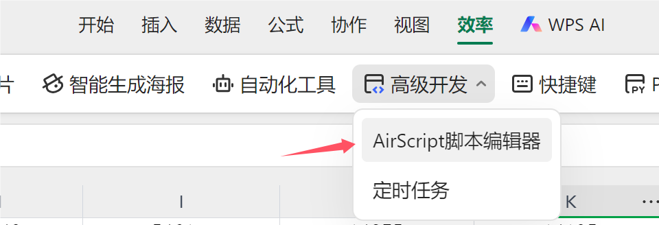
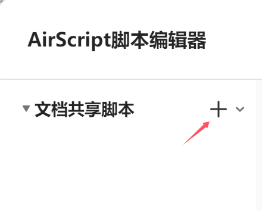
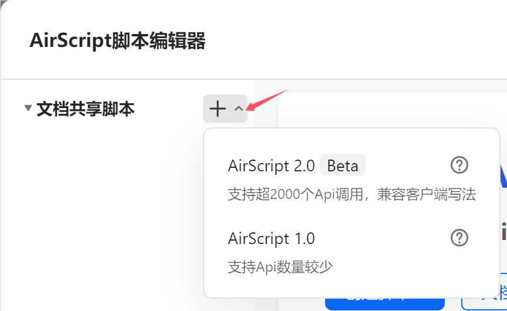
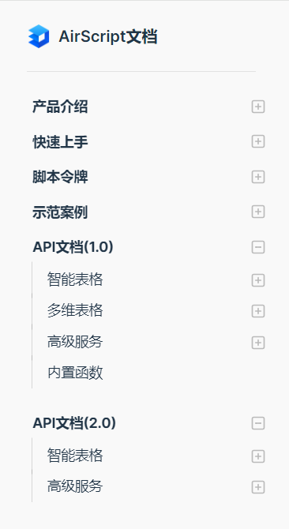
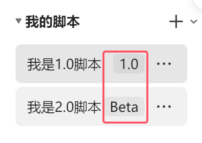

# 什么是AirScript 2.0

AirScript 1.0脚本能够满足常规的脚本操作文档需求。但在API的丰富度、执行性能、JavaScript高级语法支持上仍然存在一些限制。为了突破这些局限，我们推出了AirScript 2.0版本。

AirScript 2.0脚本采用全新的架构设计，在功能和性能上带来大幅升级，API完全兼容WPS JS宏，执行速度更快，并全面支持现代JavaScript语法。

尽管AirScript 1.0大部分API可以在AirScript 2.0兼容运行，但仍然存在一些API定义存在冲突的问题导致无法实现完全兼容，因此需要通过`1.0` `2.0`来标识脚本的运行时环境版本，AirScript 2.0是AirScript的一个大版本升级，部分API用法与AirScript 1.0无法兼容。


# AirScript 2.0有哪些亮点

### ✔️完全兼容WPS JS宏

AirScript 2.0完全兼容WPS JS宏，提供了2000+API（比1.0多4倍），极大地扩展了您的开发能力。无论您是进行简单的自动化任务，还是复杂的脚本开发，AirScript 2.0都能满足您的需求。无需重新学习新的API定义，即可在WPS端和在线表格使用同样的API开发脚本。

### 🚀更快的执行速度

我们对AirScript 2.0的逻辑执行和API调用速度进行了优化，使您的脚本运行更加高效，响应更加迅速。对于需要频繁调用API的大型脚本项目，这种性能提升尤为显著。如：循环对1000个单元格文本去除首尾空格并写回，2.0比1.0速度快1倍。

> 可以分别新建1.0和2.0脚本，执行以下代码体验2.0的性能提升

```javascript
// 对当前激活sheet第一列前1k个格子去除首尾空格，并打印脚本执行耗时
const start = Date.now();

const sheet = ActiveSheet;
for (let i = 1; i <= 1000; i++) {
  const cell = sheet.Cells(i, 1);
  cell.Value2 = cell.Text.trim();
}

console.log(Date.now() - start);
```

### 🌐全面支持现代 JavaScript 语法

AirScript 2.0全面支持现代 JavaScript 语法，如：await/async、Promise、class等语法（1.0不支持），让您的开发体验更加现代和高效。特别对于复杂的脚本项目，代码编写维护更方便。


# AirScript 2.0支持哪些场景

AirScript 2.0设计上能够满足所有AirScript 1.0具备的能力，目前一期开放支持的是工作表场景，数据表的API待开放。若您的脚本需要处理数据表场景，您可以先继续使用AirScript 1.0脚本，后续2.0我们将逐步开放支持数据表的API。

> 当前AirScript 2.0处于beta版，部分API能力将在后续迭代中持续补齐。

|  | AirScript 1.0 | AirScript 2.0 |
| --- | --- | --- |
| 工作表 | ✅API（500+） | ✅API（2000+） |
| 数据表 | ✅API | 🏗️API（待开放） |
| 高级服务 | ✅网络API ✅云文档API ✅邮件API ✅数据库API | ✅网络API ✅云文档API 🏗️邮件API（待开放） 🏗️数据库API（待开放） |


# 如何使用AirScript 2.0

> 多维表格由于涉及数据表支持，待开放

### 如何新建2.0脚本

1.打开AirScript脚本编辑器

`效率`->`高级开发`->`AirScript脚本编辑器`



2.新建脚本（文档共享脚本/我的脚本）

直接点击`+`即可新建2.0脚本



也可以通过下拉菜单选择新建脚本的版本



> “我的脚本”操作路径相同

### 如何查阅2.0文档

API文档分为1.0和2.0版本，不同版本API存在差异，2.0文档为：[API文档（2.0）](overview.md)。



### 如何判断脚本是1.0还是2.0

脚本列表中选中对应的脚本，可以查看到脚本的版本标识。`1.0`表示1.0版本，`Beta`表示2.0版本。



# 使用中可能遇到的问题

### 部分API不兼容问题

由于AirScript 2.0的API定义与WPS JS宏规范对齐，AirScript 1.0的API定义虽然参考了WPS JS宏的规范但未完全对齐，因此1.0和2.0的一小部分API参数、返回值类型、用法等存在定义冲突无法实现完全兼容，当您遇到调用的API不存在等错误时，您需要检查当前的脚本运行时环境版本以及使用的API定义版本是否一致，并根据环境和对应API文档进行API用法调整。

### API调用异常

AirScript 1.0 2.0API存在版本差异，您可先确认脚本和API文档版本是否一致，可以帮您快速定位问题。

如确认API执行存在非预期的结果，您可在[AirSheet用户社区 (wps.cn)](https://airsheet-community.wps.cn/)进行反馈，若能同时提供复现问题脚本和结果截图，将会利于我们尽快修复问题。

### AirScript 1.0存量脚本是否可以继续运行？

AirScript 1.0仍然可以正常运行，我们通过新的2.0版本来提供大版本功能升级，并保留1.0运行时环境来确保您的原有脚本不受影响，1.0 2.0版本是互相隔离的。后续我们会推出1.0升级2.0的指引。


# 性能优化Tips

尽管AirScript 2.0在性能上有显著提升，但在代码计算量特别大时仍可能遇到性能瓶颈，您可通过[最佳实践 | AirScript文档 (wps.cn)](../start/best-practice.md#%E6%80%A7%E8%83%BD%E4%BC%98%E5%8C%96)了解如何进行优化。
