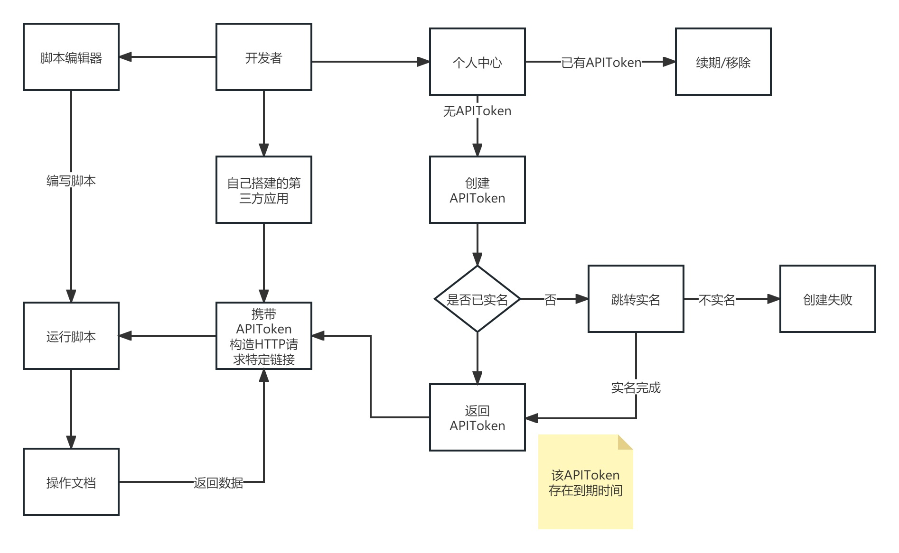
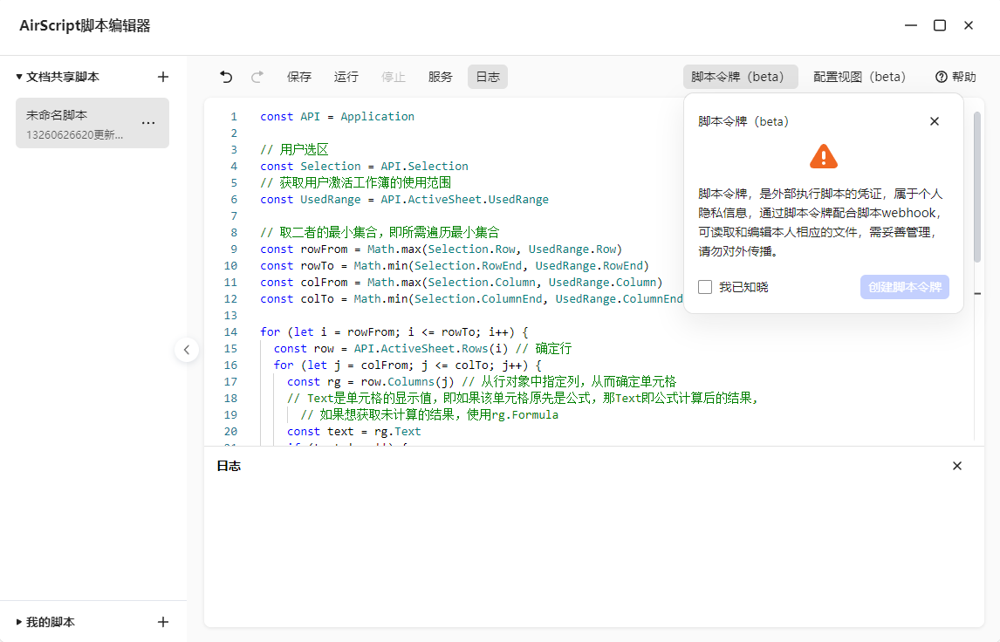
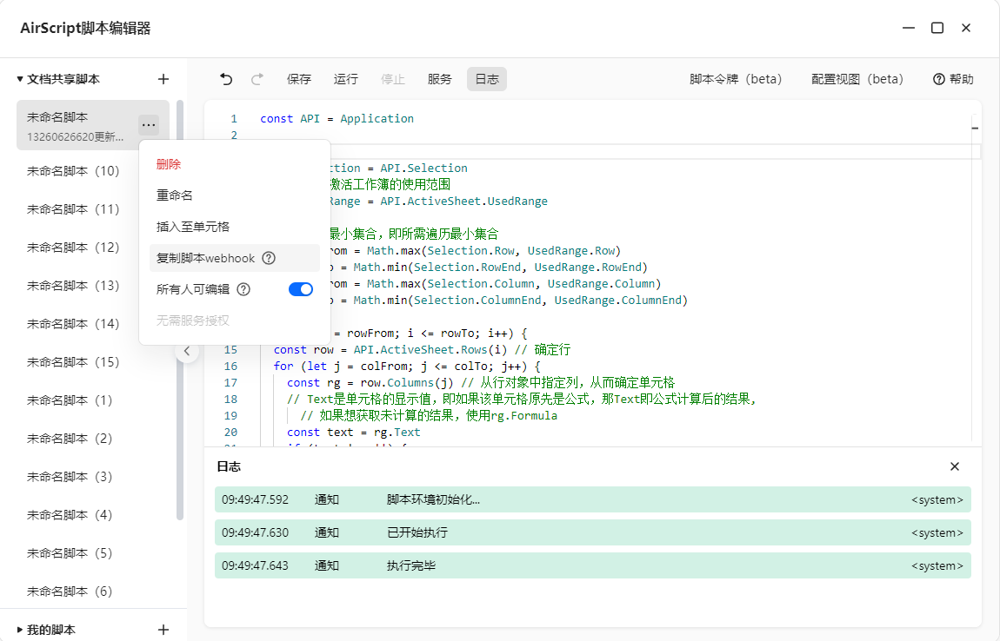

# 脚本令牌（APIToken）

开发者通过 AirScript 编辑器编写的脚本，可以直接在编辑器内运行，也可以粘贴链接在单元格运行，或者是通过定时任务面板自动运行。

但是上述几种运行方式均集成在我们的平台方，如果开发者希望在自身的业务系统内使用到 AirScript 的能力，则需要借助我们的**脚本令牌**。

## 什么是脚本令牌？

脚本令牌即 APIToken，是我们为外部系统引入 AirScript 能力而专门设计的。通过脚本令牌，您可以轻松使用到金山文档 AirScript 提供的能力，执行脚本获取文档数据或者是写入文档内容。



## 如何创建脚本令牌？

1. 进入智能表格后，打开脚本编辑器，在工具栏点击【脚本令牌（beta）】按钮
2. 如果之前未创建过脚本令牌，会提示脚本令牌创建所需要注意的点，勾选【我已知晓】，然后点击【创建脚本令牌】即可
3. 为保证一定的安全，如果您还未进行过实名认证，需要先完成实名认证流程
4. 创建成功后即可获取到您的个人脚本令牌，复制令牌信息然后妥善保存



## 如何使用脚本令牌？

脚本令牌是外部执行脚本的凭证，在您成功生成自己的脚本令牌后，便可以开始着手使用脚本令牌进行脚本的执行调用。

首先，打开脚本编辑器，在侧边栏任意一个文档脚本的更多菜单里复制脚本的 webhook 链接。

> **注意**
>
> 暂时只开放了【文档共享脚本】的 webhook 链接复制，后续将会安排【我的脚本】的 webhook。



查看复制到的链接的内容如下所示：

`https://www.kdocs.cn/api/v3/ide/file/caEkI6K5RDG2/script/V2-5rSiBiN7y5xdOd5x5ZYI2r/sync_task`

链接内已拼接好了当前脚本的脚本 ID 和所在文档的文件 ID，接下来请求该链接即可读取和编辑本人相应的文档，注意调用的时候必须设置请求头`AirScript-Token`，值为您的脚本令牌，更详细的说明请参阅[接口说明](api.md)。

这里假设目标脚本的代码如下所示，将 A1 单元格的值修改为`AirScript`，并返回一个对象:

```js
Application.Range('A1').Value2 = 'AirScript'
return {
  name: '金小朦',
  age: 17
}
```

通过脚本令牌和 webhook 我们构造了一个 http 请求，如下所示：

Shell

```shell
curl --request POST \
	--url https://www.kdocs.cn/api/v3/ide/file/caEkI6K5RDG2/script/V2-5rSiBiN7y5xdOd5x5ZYI2r/sync_task \
	--header 'AirScript-Token: xxx' \
	--header 'Content-Type: application/json' \
	--data '{"Context":{"argv":{}}}'
```

Java

```java
OkHttpClient client = new OkHttpClient();

MediaType mediaType = MediaType.parse("application/json");
RequestBody body = RequestBody.create(mediaType, "{\"Context\":{\"argv\":{}}}");
Request request = new Request.Builder()
	.url("https://www.kdocs.cn/api/v3/ide/file/caEkI6K5RDG2/script/V2-5rSiBiN7y5xdOd5x5ZYI2r/sync_task")
	.post(body)
	.addHeader("Content-Type", "application/json")
	.addHeader("AirScript-Token", "xxx")
	.build();

Response response = client.newCall(request).execute();
```

Go

```go
package main

import (
	"fmt"
	"strings"
	"net/http"
	"io/ioutil"
)

func main() {

	url := "https://www.kdocs.cn/api/v3/ide/file/caEkI6K5RDG2/script/V2-5rSiBiN7y5xdOd5x5ZYI2r/sync_task"

	payload := strings.NewReader("{\"Context\":{\"argv\":{}}}")

	req, _ := http.NewRequest("POST", url, payload)

	req.Header.Add("Content-Type", "application/json")
	req.Header.Add("AirScript-Token", "xxx")

	res, _ := http.DefaultClient.Do(req)

	defer res.Body.Close()
	body, _ := ioutil.ReadAll(res.Body)

	fmt.Println(res)
	fmt.Println(string(body))

}
```

Python

```python
import http.client

conn = http.client.HTTPSConnection("www.kdocs.cn")

payload = "{\"Context\":{\"argv\":{}}}"

headers = {
    'Content-Type': "application/json",
    'AirScript-Token': "xxx"
    }

conn.request("POST", "/api/v3/ide/file/caEkI6K5RDG2/script/V2-5rSiBiN7y5xdOd5x5ZYI2r/sync_task", payload, headers)

res = conn.getresponse()
data = res.read()

print(data.decode("utf-8"))
```

PHP

```php
<?php

$curl = curl_init();

curl_setopt_array($curl, [
	CURLOPT_URL => "https://www.kdocs.cn/api/v3/ide/file/caEkI6K5RDG2/script/V2-5rSiBiN7y5xdOd5x5ZYI2r/sync_task",
	CURLOPT_RETURNTRANSFER => true,
	CURLOPT_ENCODING => "",
	CURLOPT_MAXREDIRS => 10,
	CURLOPT_TIMEOUT => 30,
	CURLOPT_HTTP_VERSION => CURL_HTTP_VERSION_1_1,
	CURLOPT_CUSTOMREQUEST => "POST",
	CURLOPT_POSTFIELDS => "{\"Context\":{\"argv\":{}}}",
	CURLOPT_HTTPHEADER => [
		"AirScript-Token: xxx",
		"Content-Type: application/json"
	],
]);

$response = curl_exec($curl);
$err = curl_error($curl);

curl_close($curl);

if ($err) {
	echo "cURL Error #:" . $err;
} else {
	echo $response;
}
```

JS

```javascript
const data = JSON.stringify({
	"Context": {
		"argv": {}
	}
});

const xhr = new XMLHttpRequest();
xhr.withCredentials = true;

xhr.addEventListener("readystatechange", function () {
	if (this.readyState === this.DONE) {
		console.log(this.responseText);
	}
});

xhr.open("POST", "https://www.kdocs.cn/api/v3/ide/file/caEkI6K5RDG2/script/V2-5rSiBiN7y5xdOd5x5ZYI2r/sync_task");
xhr.setRequestHeader("Content-Type", "application/json");
xhr.setRequestHeader("AirScript-Token", "xxx");

xhr.send(data);
```

Node.js

```javascript
const http = require("https");

const options = {
	"method": "POST",
	"hostname": "www.kdocs.cn",
	"port": null,
	"path": "/api/v3/ide/file/caEkI6K5RDG2/script/V2-5rSiBiN7y5xdOd5x5ZYI2r/sync_task",
	"headers": {
		"Content-Type": "application/json",
		"AirScript-Token": "xxx"
	}
};

const req = http.request(options, function (res) {
	const chunks = [];

	res.on("data", function (chunk) {
		chunks.push(chunk);
	});

	res.on("end", function () {
		const body = Buffer.concat(chunks);
		console.log(body.toString());
	});
});

req.write(JSON.stringify({Context: {argv: {}}}));
req.end();
```

C

```c
CURL *hnd = curl_easy_init();

curl_easy_setopt(hnd, CURLOPT_CUSTOMREQUEST, "POST");
curl_easy_setopt(hnd, CURLOPT_URL, "https://www.kdocs.cn/api/v3/ide/file/caEkI6K5RDG2/script/V2-5rSiBiN7y5xdOd5x5ZYI2r/sync_task");

struct curl_slist *headers = NULL;
headers = curl_slist_append(headers, "Content-Type: application/json");
headers = curl_slist_append(headers, "AirScript-Token: xxx");
curl_easy_setopt(hnd, CURLOPT_HTTPHEADER, headers);

curl_easy_setopt(hnd, CURLOPT_POSTFIELDS, "{\"Context\":{\"argv\":{}}}");

CURLcode ret = curl_easy_perform(hnd);
```

C#

```csharp
var client = new RestClient("https://www.kdocs.cn/api/v3/ide/file/caEkI6K5RDG2/script/V2-5rSiBiN7y5xdOd5x5ZYI2r/sync_task");
var request = new RestRequest(Method.POST);
request.AddHeader("Content-Type", "application/json");
request.AddHeader("AirScript-Token", "xxx");
request.AddParameter("application/json", "{\"Context\":{\"argv\":{}}}", ParameterType.RequestBody);
IRestResponse response = client.Execute(request);
```

如果请求成功，将会返回如下数据，其内容主要包含脚本运行的日志信息和在代码中 return 的数据，如果您的脚本代码书写有误，相应的报错信息也会在日志中有所体现。

```json
{
  "data": {
    "logs": [
      {
        "filename": "<system>",
        "timestamp": "12:03:20.711",
        "unix_time": 1691726600711,
        "level": "info",
        "args": ["脚本环境初始化..."]
      },
      {
        "filename": "<system>",
        "timestamp": "12:03:22.129",
        "unix_time": 1691726602129,
        "level": "info",
        "args": ["已开始执行"]
      },
      {
        "filename": "<system>",
        "timestamp": "12:03:22.312",
        "unix_time": 1691726602312,
        "level": "info",
        "args": ["执行完毕"]
      }
    ],
    "result": {
      "age": 17,
      "name": "金小朦"
    }
  },
  "error": "",
  "status": "finished"
}
```

## 注意事项

1. 由于脚本令牌允许第三方访问到平台的服务端资源，为提高一定的**安全性**，我们需要您完成实名认证（已认证可忽略）
2. 脚本令牌，是外部执行脚本的凭证，属于**个人隐私信息**，通过脚本令牌配合脚本 webhook，可读取和编辑本人相应的文件，需妥善管理，请勿对外传播
3. 脚本令牌与用户绑定，每个用户最多**有且仅有一个**脚本令牌，创建新的令牌时，需要先对老令牌进行删除（重新创建的脚本令牌需与原令牌不同）
4. 脚本令牌默认 180 天到期，用户可在创建时手动进行延期，不做限制，可多次延期
