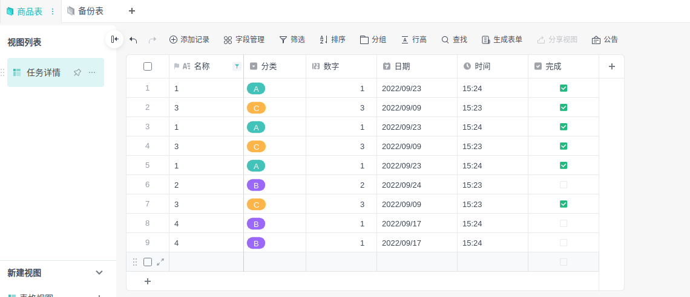

# 多维表案例

此处提供了一些多维表脚本开发示范实例，希望能为您快速理解和上手多维表脚本开发提供帮助。

## 选中区域快速批量填值

```javascript
function main() {
  var activeView = Application.Selection.GetActiveView()

  var selectedRecords = Application.Selection.GetSelectionRecords()[0]
  var time = getNowTime()
  var date = getNowDate()

  // 注意，这里的 “日期”， “时间”， “分类”， 需要替换到您表中的响应字段名
  Application.Record.UpdateRecords({
    SheetId: activeView.sheetId,
    Records: selectedRecords.map(item => ({
      id: item.id,
      fields: {
        日期: date,
        时间: time,
        分类: 'B'
      }
    }))
  })
}
// 获取当前时间，格式为 "hh:mm:ss"
function getNowTime() {
  return new Date().toTimeString().split(' ')[0]
}
// 获取当前日期，格式为 "yyyy:MM:dd"
function getNowDate() {
  var date = new Date()
  return date.getFullYear() + '/' + (date.getMonth() + 1) + '/' + date.getDate()
}

main()
```

## 快速实现“一键归档”

下面代码实现了一个文件中两张数据结构相同的表，把表一中的已完成的数据插入到表二中，并删除表一中数据。

表结构如图所示： 

```javascript
function main() {
  var sheets = Application.Sheet.GetSheets()
  // 筛选出 打钩的 并且是分类 B 中的数据
  var finishedRecords = Application.Record.GetRecords({
    SheetId: sheets[0].id,
    Filter: {
      mode: 'AND',
      criteria: [
        {
          field: '完成',
          op: 'Equals',
          values: ['1']
        },
        {
          field: '分类',
          op: 'Equals',
          values: ['B']
        }
      ]
    }
  })
  // 如果存在 筛选出来的数据
  if (finishedRecords) {
    // 在表二中插入数据
    Application.Record.CreateRecords({
      SheetId: sheets[1].id,
      Records: finishedRecords.records.map(item => ({
        fields: item.fields
      }))
    })
    // 在表一中删除数据
    Application.Record.DeleteRecords({
      SheetId: sheets[0].id,
      RecordIds: finishedRecords.records.map(item => item.id)
    })
  }
}
main()
```

> **说明**
>
> 📌 结合上面两个例子，可以实现自动设置归档日期和时间，或者选中记录一键归档等等功能

## 快速创建一张表

```javascript
function main() {
  Application.Sheet.CreateSheet({
    Name: '我的表',
    Fields: [
      { name: '名称', type: 'MultiLineText' },
      { name: '数量', type: 'Number' },
      { name: '日期', type: 'Date' },
      { name: '时间', type: 'Time' },
      { name: '复选框', type: 'Checkbox' },
      { name: '超链接', type: 'Url' },
      { name: '等级', type: 'Rating', max: 5 },
      { name: '电话', type: 'Phone' },
      { name: '身份证', type: 'ID' },
      { name: '货币', type: 'Currency' },
      { name: '百分比', type: 'Percentage' },
      { name: '邮箱', type: 'Email' },
      { name: '进度', type: 'Complete' },
      {
        name: '分类',
        type: 'SingleSelect',
        items: [{ value: 'A' }, { value: 'B' }, { value: 'C' }]
      },
      {
        name: '状态',
        type: 'MultipleSelect',
        items: [{ value: '已完成' }, { value: '未开始' }, { value: '进行中' }]
      },
      {
        name: '联系人',
        type: 'Contact',
        multipleContacts: false,
        noticeNewContact: false
      },
      { name: '富文本', type: 'Note' },
      { name: '附件', type: 'Attachment' },
      { name: '公式', type: 'Formula' },
      { name: '创建时间', type: 'CreatedTime' },
      { name: '创建者', type: 'CreatedBy' },
      { name: 'AutoNumber', type: 'AutoNumber' }
    ],
    Views: [
      { name: '表格', type: 'Grid' },
      { name: '看板', type: 'Kanban' },
      { name: '画册', type: 'Gallery' },
      { name: '表单', type: 'Form' },
      { name: '甘特', type: 'Gantt' }
    ]
  })
}
main()
```

## 格式化数据批量插入

```javascript
function main() {
  var template = ['商品', 10]
  var records = []
  // 插入 100 条 A 类商品，
  for (let i = 1; i < 100; i++) {
    records.push({
      名称: template[0] + i,
      数量: template[1],
      分类: 'A'
    })
  }
  for (let i = 1; i < 100; i++) {
    records.push({
      名称: template[0] + (100 + i),
      数量: template[1] + 10,
      分类: 'B'
    })
  }
  for (let i = 1; i < 100; i++) {
    records.push({
      名称: template[0] + (200 + i),
      数量: template[1] + 10,
      分类: 'C'
    })
  }
  var sheet = Application.Selection.GetActiveSheet()
  Application.Record.CreateRecords({
    SheetId: sheet.sheetId,
    Records: records.map(item => ({
      fields: item
    }))
  })
}
main()
```
