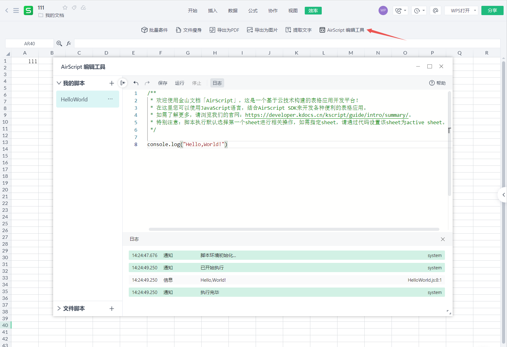

# AirScript 概述

金山文档 AirScript 是一个简单快速的轻量级脚本应用开发平台，它基于云技术构建，可让您快速轻松地创建与金山文档 Office 文件交互的业务应用。

我们在金山文档的组件中提供了代码编辑器，您的代码将会安全地运行在我们的服务端上。您可以使用现代 JavaScript 语言编写逻辑代码，并可以调用 AirScript 内置强大的组件（表格）API 来构建特定场景的解决方案。

目前在国内业界中尚未出现类似的产品，金山文档 AirScript 是国内首家提供该服务的平台。

## AirScript 能做什么

AirScript 目前主要为在线表格、多维表打造二开平台，通过编程的方式，提供对表格数据的增删查改、单元格式修改、属性设置等能力。

#### 工具优势

- 无需搭建本地环境，直接在文档内进行脚本云开发。
- 内置定制化的全局 Application 对象，编辑器智能提示，开发、调试、运行一条龙服务。
- 同步获取属性，同步执行方法，减少传统的异步调用带来的心智负担。
- 得益于集成化开发环境，无论是创建定时任务，还是批量处理数据，亦或是自动化生成文档，开发者可以在这里尽情发挥自己的想象力。

## 如何使用 AirScript

打开在线表格 KSheet，切换至「效率」Tab，在下方二级工具栏找到「AirScript 编辑工具」，点击即可调起 AirScript 编辑器，如图： 

> **提示**
>
> 有文件编辑权限的协作者才能打开开发工具

### 编辑器功能介绍

脚本编辑器分左右两部分，左边部分为脚本文件管理区域；右边部分为编码及运行区域。功能上提供脚本的增删改、运行及运行时生成提示日志的能力。

文档操作 API 方面，编辑器内置了 Application 对象语法提示，可直接根据文档及语法提示书写需要的 OpenApi。

具体功能介绍：

- 脚本管理
  - 编辑器左侧及右侧顶部操作区域，提供代码文件的新建、保存、删除、运行等常规操作；
  - 脚本文件存储在云端，并分为【我的脚本】和【文档共享脚本】，其中我的脚本跟随账号，文档共享脚本跟随当前文档；
- 代码编辑
  - 代码编辑器基于开源`monaco editor`进行二开，用户操作基本类似`VS Code`；
  - 代码保存
    - 表格：代码自动保存在本地，但不自动同步云端，需要用户主动点击「保存」或者「Ctrl+S」才会同步云端，未同步的代码文件会在文件名前方展示一个「小绿点」；
    - 多维表：多维表切换脚本及关闭开发工具会自动保存代码并同步云端；
- 执行日志
  - 显示代码的执行信息，用户可根据返回信息查看脚本的执行状态以及打印结果；
  - 如果代码报错，将会打印错误信息及位置，点击位置编辑器会定位到错误代码块。
